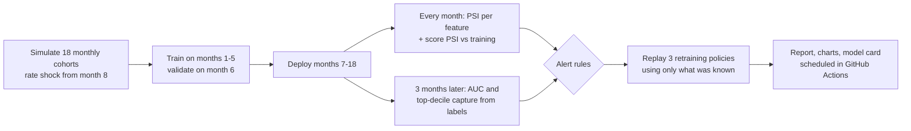
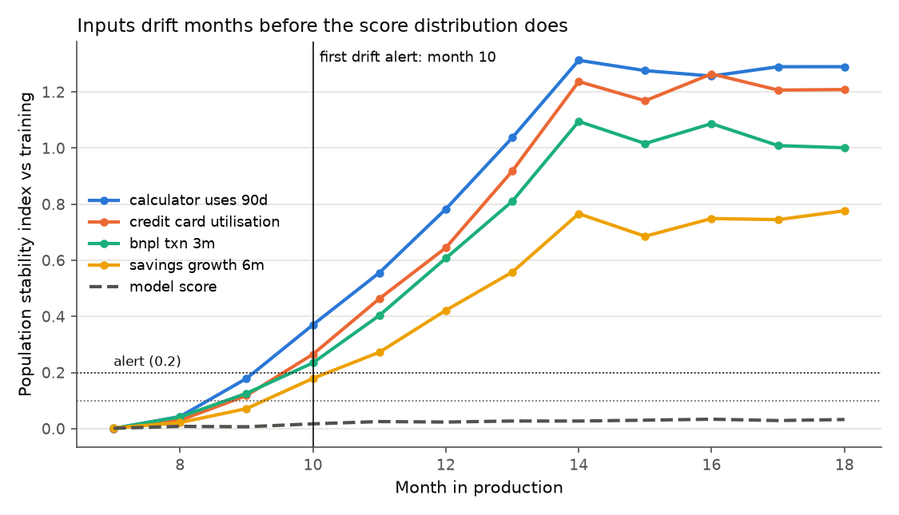
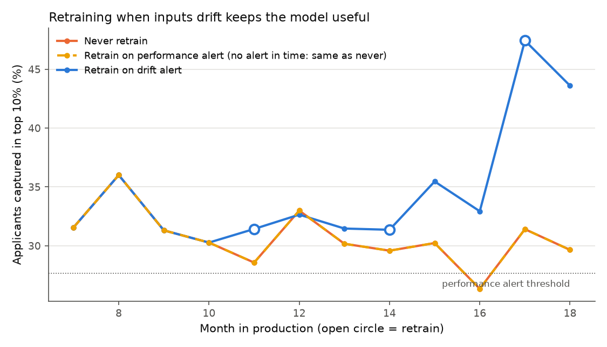

# Model Monitoring Pipeline

**A propensity model goes live, then interest rates rise. How soon do you find out it's going stale, and what should you do about it?**

**At a glance:** I replayed 12 months of production for a first home buyer propensity model through a simulated rate shock.
- **Input-drift monitoring raised the alarm in month 10.** Waiting for outcome labels, which arrive 3 months late, confirmed the decay only in month 19, after the 18-month window had ended. That's **9 months later**.
- **The model's score distribution barely moved** (PSI never above 0.04). Monitoring the score alone would have missed the shift entirely.
- **Retraining when drift fires** kept **36% of future applicants in the top 10%**, against **30%** for never retraining. Across 5 random seeds the gain was **+5 to +11 points**, never negative.

`Python 3.12` · `LightGBM` · `PSI drift detection` · `time-based validation` · `label-lag-aware retraining` · `GitHub Actions (scheduled)` · `model card` · `pytest`

> **All data is synthetic.** No real customers. A personal portfolio project, not affiliated with or endorsed by any bank. Nothing here is financial advice.

---

## 1. The problem

My [first home buyer model](https://github.com/Shru2006/first-home-buyer-lead-intelligence) is accurate on the day it's trained. Real models decay: customer behaviour shifts, and the patterns the model learned stop holding. Two things make this hard in lending:

1. **Labels arrive late.** "Applied within 90 days" is only known 3 months after a customer is scored, so performance metrics are always a quarter behind.
2. **Drift doesn't always show in the score.** When some inputs push scores up and others push them down, the score distribution can look stable while the model gets worse.

## 2. Approach



| Step | File | What it does |
|---|---|---|
| Simulate | [`src/simulate.py`](src/simulate.py) | 18 cohorts of 6,000 customers. From month 8 a rate shock builds. **Data drift:** savings growth falls, credit card and buy-now-pay-later use rise, calculator use rises (people re-checking what they can afford). **Concept drift:** research activity predicts applying less, and deposit readiness matters more. The application rate falls from about 9% to under 3%. |
| Metrics | [`src/metrics.py`](src/metrics.py) | Population stability index (PSI) on the training data's deciles, and AUC and top-decile capture. |
| Monitor | [`src/monitor.py`](src/monitor.py) | Each month: feature and score PSI. Performance for the cohort scored 3 months earlier. Replays three retraining policies **without peeking**: a retrain may only use cohorts whose labels were already known (a unit test enforces this). |
| Robustness | [`src/robustness.py`](src/robustness.py) | Re-runs the whole simulation on 5 random seeds. |
| Report | [`src/report.py`](src/report.py) | Charts plus [`reports/monitoring_report.md`](reports/monitoring_report.md), a month-by-month table. |
| Model card | [`MODEL_CARD.md`](MODEL_CARD.md) | Purpose, limits, monitoring rules and retraining policy in one page. |
| Schedule | [`.github/workflows/monitor.yml`](.github/workflows/monitor.yml) | Runs on the 1st of every month and on every push: tests, monitor, and the report published to the run summary and as a downloadable artifact. |

## 3. Results



**Inputs move, the score doesn't.** Calculator use, credit card utilisation, buy-now-pay-later and savings growth all pass the 0.2 alert line by month 10 and keep climbing. The model's score distribution stays below 0.04 throughout, because some shifts push scores up and others push them down.



| Policy | Mean top-decile capture, months 7-18 | Months 12-18 (after the shock) | Retrains |
|---|---|---|---|
| Never retrain | 30.7% | 30.1% | none |
| Retrain on performance alert | 30.7% | 30.1% | none: the decay was confirmed too late |
| **Retrain on drift alert** | **34.6%** | **36.4%** | months 11, 14, 17 |

Baseline before deployment: AUC 0.749, top-decile capture 32.5%.

### Does it hold beyond one run? (5 random seeds)

| Seed | First drift alert | Performance alert confirmed | Never retrain (months 12-18) | Retrain on drift (months 12-18) |
|---|---|---|---|---|
| 1 | month 10 | not within window | 30.7% | 35.7% |
| 2 | month 10 | month 18 | 27.2% | 35.2% |
| 3 | month 10 | month 17 | 28.9% | 37.0% |
| 4 | month 10 | month 17 | 27.1% | 36.7% |
| 5 | month 10 | month 14 | 24.3% | 35.2% |

The drift alert fired in month 10 every time. Label-based confirmation came 4 months later at best, and not at all at worst. Retraining on drift gained **+5.1 to +10.9 points** (mean +8.3).

## 4. Design decisions and limitations

| Decision | Why |
|---|---|
| **Respect the label lag everywhere** | Using labels before they exist is the most common way monitoring backtests flatter themselves. Every retrain records which months it trained on, and a test checks that each was known at the time. |
| **Monitor inputs, not just the score** | Here the score was stable while four inputs moved a lot. Score-only monitoring would have stayed green. |
| **Time-based validation for the baseline** | Train on months 1-5, validate on month 6. A random split would mix future and past and overstate performance. |
| **Retrain on a rolling 6 labelled months** | Recent enough to learn the new pattern, large enough to be stable. |
| **Scheduled job, not a notebook** | Monitoring only works if it runs without someone remembering to. |

**Limitations:** the shock is designed, so this shows the method, not how a real portfolio would behave. A drift-triggered retrain trains partly on pre-shift labels. It worked here because the shift built up gradually; a sudden break would need a different policy. A production version should also **promote a retrained model only if it beats the current one** on the latest labelled month. That champion-challenger check isn't built yet.

## 5. Run it yourself

```bash
git clone https://github.com/Shru2006/model-monitoring-pipeline.git
cd model-monitoring-pipeline
python -m venv .venv
.venv\Scripts\activate            # macOS/Linux: source .venv/bin/activate
pip install -r requirements.txt

python -m src.simulate            # 1. 18 months of synthetic cohorts
python -m src.monitor             # 2. drift, performance, retraining policies, report
python -m src.robustness          # 3. repeat on 5 seeds (about 30 seconds)
pytest -q
```

## 6. What I would do next

- Champion-challenger promotion: a retrained model goes live only if it beats the current one on the latest labelled month.
- Track experiments and model versions in MLflow, and package the job in Docker.
- Alert routing (email or chat) with the top drifting features and a suggested action.
- Segment-level monitoring, so a shift in one region or customer group isn't averaged away.

---

**Author:** Shruti Prabhu · [LinkedIn](https://www.linkedin.com/in/shruti-prabhu-32b77477) · [GitHub](https://github.com/Shru2006)
